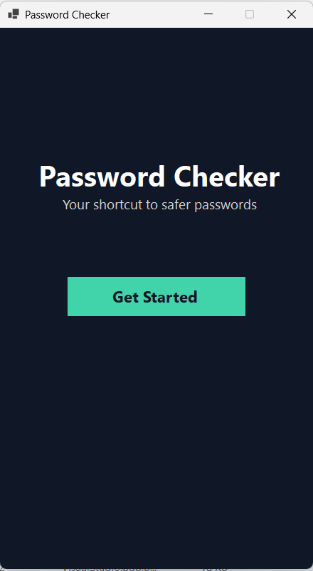
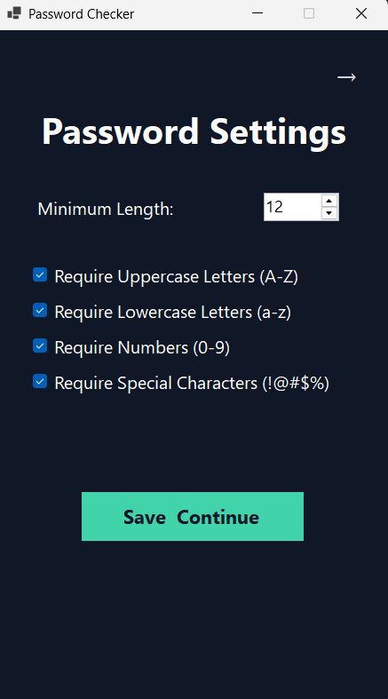
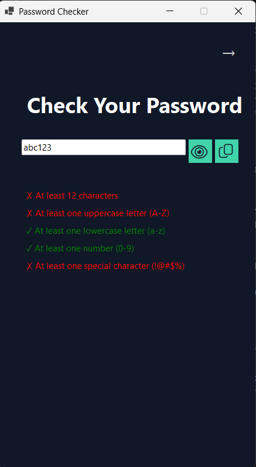
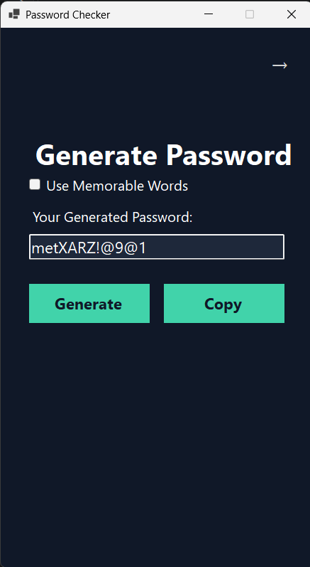

# PasswordChecker
## About the project
PasswordChecker is a simple windows application that helps the user to create new passwords due the service requirments. The app will let the user enter his password and will check when the password meets the requirements and let the user know about it or the user can let the app generate a password for him, the password may be random letters and numbers and special characters or it may be made by real words that are easy to remember.

 I built this app because on many websites almost every time you will enter a password a "this password is not strong enough" message will show up and the user will need to create a new password, this tool allows the user to see in real time when he types the password to see if it meets the requirments or to create a new password that meets the requirements.

 ## Features
 **Costomizable password requirements**: The user can set the requrirmets for the password.
 
 **Real time password validation**: The user can see in real time as they type the password if it meets the requirements yet.

 **Random password generator**: The app will generate a random password that meets the requirements set by the user.

 **Memorable password generator**: The app will generate a password made up of real words that are easy to remember and meets the requirements set by the user.

 **Hide password**: the user can hide the password he types.

 **Copy password to clipboard**: The user can copy the password he types or the password generated by the app to the clipboard.

 ## Screenshots & Demo
  
 
 
 

 ###  Video Demo:
 [Watch the PasswordChecker Demo](https://youtube.com/shorts/64o2iEbu-sE)

 ## Installation

 ### Requirements

 - Windows 64-bit
  
  ### Steps

  1. Download the ZIP file from the [PasswordChecker v1.0.0 release page](https://github.com/Eitan1012/PasswordChecker-4/releases/tag/v1.0.0).
  2. Extarct all the files from the zip to a folder.
  3. Open the folder and run the PasswordChecker.exe file to start the application.
   
## How to Use

### Check a Password

1. Open the PasswordChecker application.
2. Set the password requirements in the settings screen.
3. Select the "Check Password" option from the main menu.
4. Type the password you want to check.
5. The app will validate the password in real time.

### Generate a Password

1. Open the PasswordChecker application.
2. Set the password requirements in the settings screen.
3. Select the "Generate Password" option from the main menu.
4. Choose whether to generate a random or memorable password.
5. Click "Generate" to create a password.


## Development Setup

### Requirements
- Windows
- .NET 8 SDK
- Git

### Running from Source

open a terminal and run the following commands to clone the repository and run the application:

```powershell
git clone https://github.com/Eitan1012/PasswordChecker-4.git
cd PasswordChecker-4
dotnet run
```
## Tech Stack
- C# - Programming Language
- .NET 8 - Framework
- WinForms - UI
- System.Security.Cryptography - For password generation
- EFF Wordlist - For memorable password generation

## How it works

### Password Validation
The password validation is done by checking the password against the requirements set by the user. The app will check for the following requirements:
- Minimum length
- Is Uppercase required
- Is Lowercase required
- Is Number required
- Is Special Character required

###  Random Password Generation
The random password generation is done by using the System.Security.Cryptography library to generate a random password that meets the requirements set by the user. The app will generate a password that contains random letters, numbers, and special characters.

### Memorable Password Generation
The memorable password generation is done by using the EFF Wordlist to generate a password that is made up of real words that are easy to remember and meets the requirements set by the user. The app will randomly select words from the EFF Wordlist and combine them to create a password that meets the requirements.


## Chalenges

One of the main challenges I faced in this application development process was the UI design, because I developed the app in VSCODE and not in Visual Studio, iI had no real time visual UI designer so every time I wanted to change a size or the position of a control I had to run the app and see how it looks and then go back to the code and change it and do this process over and over again until the result was good, this process took a lot of time and was very frustrating, but in the end I managed to create a good looking UI.

### What i learned

Because of this challenge I learned how to design a good looking UI manually from the code without a visual designer.


## AI Disclosure

I used AI (ChatGPT) for the following tasks:

- To  find a good looking RGB color combination for the application.
- To find a good looking font for the application.
- To find the EFF wordlist for the memorable password generator.